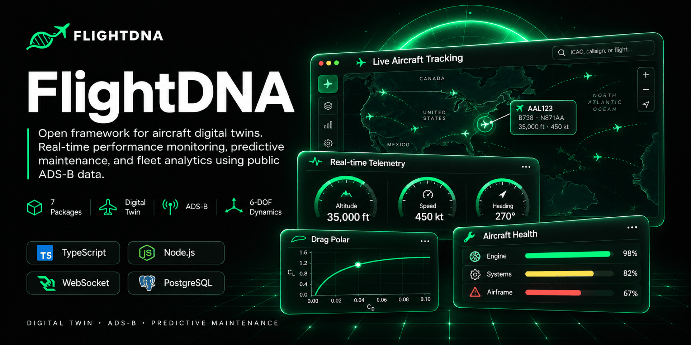

<p align="center">
  
</p>

<p align="center">
  <a href="https://www.npmjs.com/package/@flightdna/core"></a>
  <a href="./LICENSE"></a>
  
  
</p>

Open framework for aircraft digital twins — real-time performance monitoring, predictive maintenance, and fleet analytics using public ADS-B data.

## Packages

| Package | Description | npm |
|---------|-------------|-----|
| `@flightdna/core` | Core types, event emitter, and pipeline orchestrator | [](https://www.npmjs.com/package/@flightdna/core) |
| `@flightdna/adsb` | ADS-B message decoder and OpenSky Network API client | [](https://www.npmjs.com/package/@flightdna/adsb) |
| `@flightdna/weather` | NOAA weather client and atmospheric model (ISA, wind, density) | [](https://www.npmjs.com/package/@flightdna/weather) |
| `@flightdna/dynamics` | 6-DOF flight dynamics, drag polar estimation, performance metrics | [](https://www.npmjs.com/package/@flightdna/dynamics) |
| `@flightdna/twin` | Digital twin with Kalman filter, health monitoring, anomaly detection | [](https://www.npmjs.com/package/@flightdna/twin) |
| `@flightdna/fleet` | Fleet management, comparative analytics, route analysis | [](https://www.npmjs.com/package/@flightdna/fleet) |
| `@flightdna/export` | Export to CSV, JSON, Parquet and generate flight reports | [](https://www.npmjs.com/package/@flightdna/export) |

## Quick Start

```bash
npm install @flightdna/core @flightdna/adsb @flightdna/twin
```

```ts
import { FlightDNA } from "@flightdna/core";
import { OpenSkyClient } from "@flightdna/adsb";
import { DigitalTwin } from "@flightdna/twin";

// Create an OpenSky client for live ADS-B data
const opensky = new OpenSkyClient();

// Track a specific aircraft by ICAO24 address
const states = await opensky.getStates({ icao24: ["a1b2c3"] });

// Create a digital twin for the aircraft
const twin = new DigitalTwin({ icao24: "a1b2c3" });

// Feed ADS-B states into the twin
for (const state of states) {
  twin.update(state);
}

// Get current estimated state and health indicators
const twinState = twin.getState();
console.log(twinState.position);       // { lat, lon, altitude }
console.log(twinState.performance);    // { mach, climbRate, fuelFlow }
console.log(twinState.health);         // { engineHealth, fatigueIndex }
```

## Architecture

FlightDNA processes aircraft data through a modular pipeline:

```
ADS-B Surveillance Data (OpenSky Network)
    |
    v
[@flightdna/adsb] Decode Mode S / ADS-B messages
    |
    v
[@flightdna/weather] Enrich with atmospheric conditions (NOAA)
    |
    v
[@flightdna/dynamics] Flight dynamics model (forces, coefficients)
    |
    v
[@flightdna/twin] Digital twin state estimation (Kalman filter)
    |
    v
[@flightdna/fleet] Fleet-wide analytics and comparison
    |
    v
[@flightdna/export] Reports, CSV, JSON, Parquet
```

Each package is independently usable. You can use `@flightdna/adsb` alone to decode ADS-B data, or `@flightdna/dynamics` standalone for flight dynamics calculations.

## Tech Stack

- [TypeScript](https://www.typescriptlang.org/) (strict mode)
- [Turborepo](https://turbo.build/) + [pnpm](https://pnpm.io/) workspaces
- [tsup](https://tsup.egoist.dev/) (ESM + CJS builds)
- [Vitest](https://vitest.dev/) for testing
- [Changesets](https://github.com/changesets/changesets) for versioning

## Data Sources

- **[OpenSky Network](https://opensky-network.org/)** — Live and historical ADS-B surveillance data
- **[NOAA](https://www.noaa.gov/)** — METAR, TAF, and upper air sounding weather data
- **Public aircraft databases** — Aircraft type, registration, and operator information

## Research

FlightDNA is designed as a research tool for aircraft performance analysis using publicly available surveillance data. A paper describing the framework is planned for submission to the [Journal of Open Source Software (JOSS)](https://joss.theoj.org/).

If you use FlightDNA in your research, please cite the Zenodo archive (DOI will be available after first release).

## Development

```bash
git clone https://github.com/kingofmit/flightdna.git
cd flightdna
pnpm install
pnpm build
pnpm test
```

See [CONTRIBUTING.md](./CONTRIBUTING.md) for more details.

## License

[MIT](./LICENSE) - [Ahmed Allem](https://kingallem.com)
